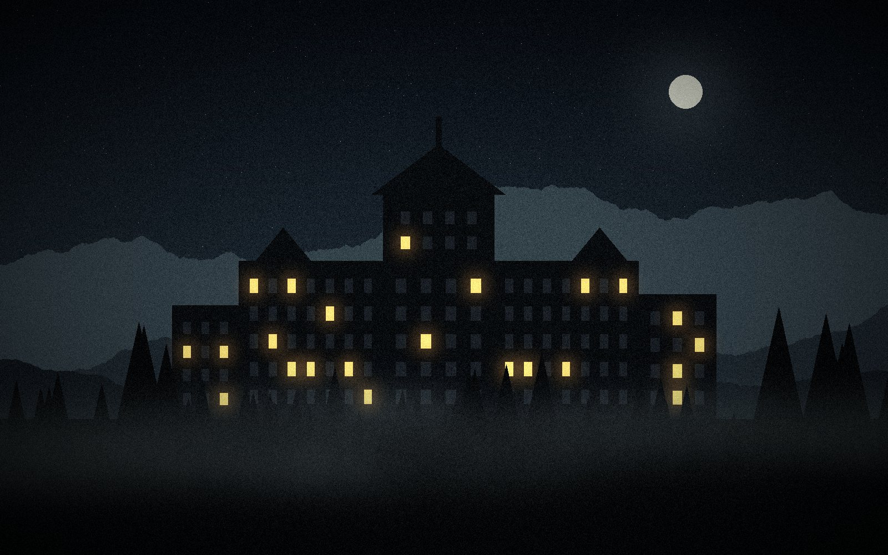
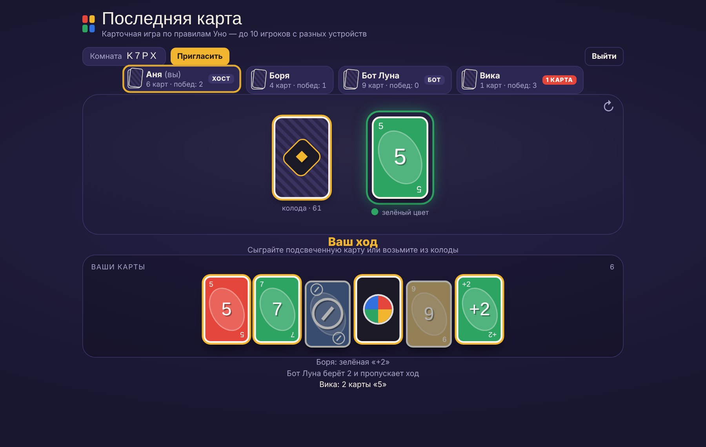
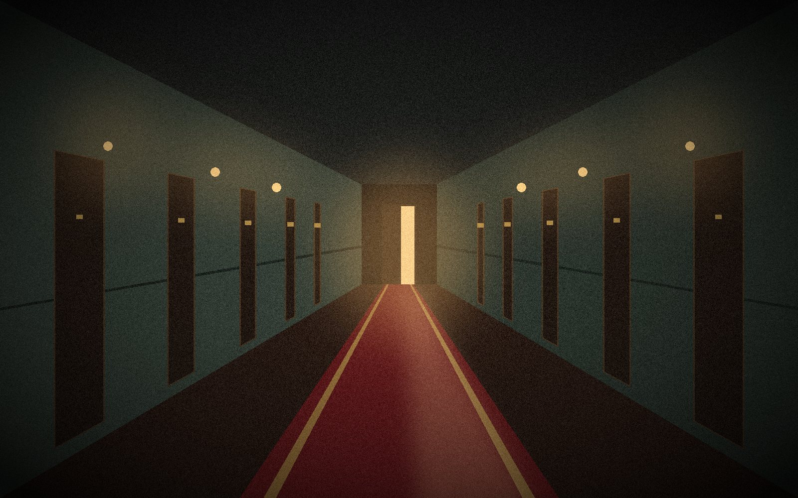
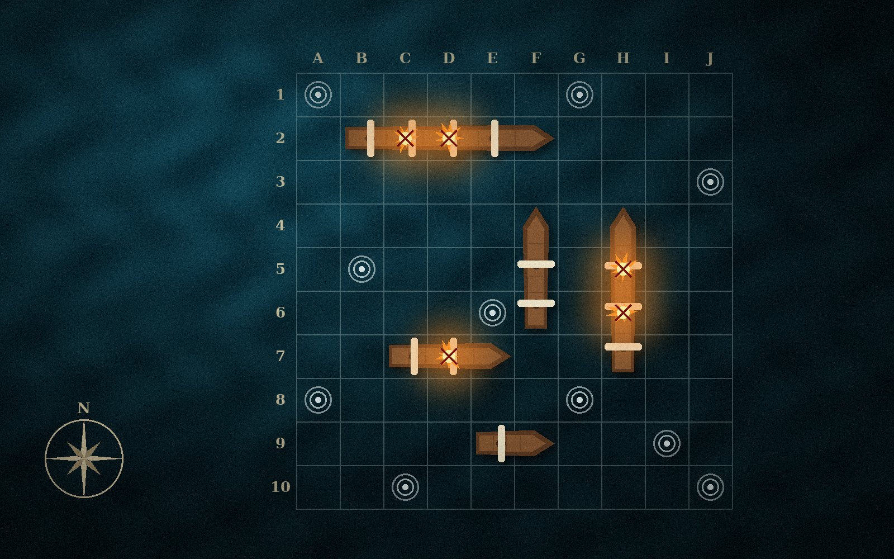
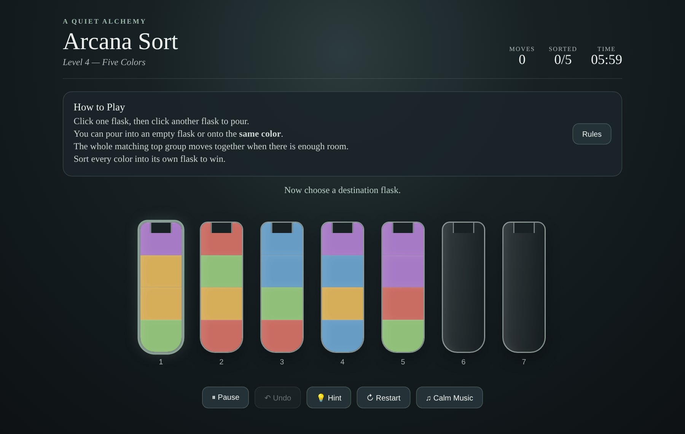

<div align="center">


# Moth & Lantern

**Portfolio website of an independent game studio**

Narrative mysteries and real-time multiplayer games for PC and the browser.

[**Live site**](https://moth-and-lantern.onrender.com) · [Projects](#-featured-projects) · [Getting started](#-getting-started) · [Prompts](#-development-prompts)




</div>

---

## 📖 About

**Moth & Lantern** is a fictional independent game studio, created as a portfolio project.
The website presents the studio the way a real company would: who we are, what we have made,
how we work, and how to order a game. Every project shown on the site is a real, playable game.

The site includes:

- information about the studio and its founder, presented as a CV;
- projects with links to the live games and their source code;
- a gallery with filters and a full-screen viewer;
- a consultation form that sends requests straight to **Telegram**.

---

## ✨ Features

| | Feature | Description |
|---|---|---|
| 🏮 | **Lantern hero** | The home screen is dark. A lantern follows the cursor (or the finger on a phone) and lights up the hotel, while moths circle the flame. |
| 🧮 | **Project estimate** | Visitors choose a game type, size and features and instantly see a rough timeline and budget. The estimate can be attached to the request. |
| 🌐 | **English / Russian** | The whole site switches between two languages. The choice is detected from the browser and remembered. |
| 🗂 | **Projects as case files** | Each project has a status, tech stack and buttons to play the game or open its source code. |
| 🖼 | **Gallery** | Filter by project, open any image full-screen, and navigate with arrow keys or a swipe. |
| ✉️ | **Telegram form** | Requests are validated and sent to a Telegram bot through the server, so the bot token never reaches the browser. |
| 🛡 | **Spam protection** | A hidden honeypot field and a rate limit of 5 requests per 10 minutes per visitor. |
| 📱 | **Responsive** | Works on phones, tablets and desktops. Respects the "reduce motion" system setting. |

---

## 🎮 Featured Projects

| | Project | Genre | Links |
|---|---|---|---|
|  | **Last Card** | Online multiplayer card game (2–10 players) | [Play](https://uno-with-friends-online.onrender.com) · [Source](https://github.com/MairamKenzh/uno-with-friends-online) |
|  | **Case History** | Mystery point-and-click, Unity — *in production* | — |
|  | **Battle at Sea — Pirate Edition** | Naval strategy, vs computer or 2 players | [Play](https://battle-at-see-pirate-edition.vercel.app/) |
|  | **Arcana Sort** | Calm alchemy sorting puzzle | [Play](https://arcana-sort.vercel.app/) · [Source](https://github.com/MairamKenzh/arcana-sort) |

---

## ⚙️ Technical Requirements

### Functional requirements

| ID | Requirement |
|---|---|
| FR-1 | The site presents the studio, its services and its founder. |
| FR-2 | Each project shows a description, status, tech stack and links to the live game and the repository. |
| FR-3 | The gallery can be filtered by project and opened in a full-screen viewer. |
| FR-4 | The estimate calculator shows a timeline and budget based on the selected options. |
| FR-5 | The consultation form validates the input on both the client and the server. |
| FR-6 | A valid request is delivered to the studio's Telegram chat within seconds. |
| FR-7 | All content is available in English and Russian. |

### Non-functional requirements

| Category | Requirement |
|---|---|
| Security | The bot token is stored only in environment variables and is never sent to the browser. |
| Reliability | Invalid or spam requests are rejected; the rate limit prevents flooding. |
| Performance | No frameworks and no dependencies; the lantern animation pauses when it is off screen. |
| Compatibility | Current Chrome, Edge, Firefox and Safari on desktop and mobile. |
| Accessibility | Keyboard navigation, visible focus, alt text for images, reduced-motion support. |

### System requirements

| Item | Requirement |
|---|---|
| Runtime | Node.js **20.6** or newer |
| Dependencies | None — `npm install` is not required |
| Environment variables | `BOT_TOKEN`, `CHAT_ID`, optional `PORT` |
| Hosting | Any Node.js host (deployed on Render) |

---

## 🧰 Tech Stack

| Layer | Technology |
|---|---|
| Frontend | HTML5, CSS3, vanilla JavaScript, Canvas API |
| Backend | Node.js (built-in `http`, `fs` and `fetch`) |
| Notifications | Telegram Bot API (`sendMessage`) |
| Fonts | Fraunces, Manrope, IBM Plex Mono (Google Fonts) |
| Hosting | Render · source code on GitHub |

### How the form works

```
Browser form ──POST /api/contact──▶ Node.js server ──sendMessage──▶ Telegram bot ──▶ studio chat
                                    • validation
                                    • honeypot
                                    • rate limit
```

---

## 📁 Project Structure

```
moth-and-lantern/
├── server.js          # static file server + /api/contact → Telegram
├── package.json       # start scripts, no dependencies
├── .env.example       # template for BOT_TOKEN and CHAT_ID
├── .gitignore         # keeps .env out of GitHub
└── public/
    ├── index.html     # all page content
    ├── styles.css     # design and layout
    ├── main.js        # lantern, gallery, calculator, form
    ├── i18n.js        # Russian translation
    └── assets/
        ├── logo.svg
        └── gallery/   # project screenshots and concept art
```

---

## 🚀 Getting Started

1. **Clone the repository**
   ```bash
   git clone https://github.com/MairamKenzh/moth-and-lantern.git
   cd moth-and-lantern
   ```
2. **Create a `.env` file** next to `server.js`:
   ```env
   BOT_TOKEN=123456789:AAxxxxxxxxxxxxxxxxxxxxxxxxxxxxxxx
   CHAT_ID=123456789
   ```
3. **Start the site**
   ```bash
   npm run dev        # Windows PowerShell: npm.cmd run dev
   ```
4. Open **http://localhost:3000**

> Without a `.env` file you can still run `npm start`. The site works, but the form will not reach Telegram.

### Setting up the Telegram bot

1. In Telegram, open **@BotFather**, send `/newbot` and follow the steps. Copy the **token** — this is `BOT_TOKEN`.
2. Open your new bot and press **Start** (otherwise the bot cannot message you).
3. Open **@userinfobot** and press **Start**. It replies with your **Id** — this is `CHAT_ID`.

---

## ☁️ Deployment (Render)

| Setting | Value |
|---|---|
| Service type | Web Service |
| Language | Node |
| Build Command | *(leave empty)* |
| Start Command | `npm start` |
| Environment | `BOT_TOKEN`, `CHAT_ID` |

Every `git push` to `main` redeploys the site automatically.

---

## 🔧 Configuration

| What | Where |
|---|---|
| Estimate prices and timelines | `public/main.js` → `BASE`, `SIZE`, `FEAT` |
| Russian translation | `public/i18n.js` |
| Lantern darkness, light size, number of moths | `public/main.js` → section `3. LANTERN` |
| Page text and projects | `public/index.html` |

---

## 💬 Development Prompts

This website was built with the help of an AI assistant (Claude). Below are the prompts used during development, translated into English.

### Prompt 1 — The website

> **Task:** a portfolio website with projects, presented on behalf of a game development company. I am the company — I am the developer — but please make it look like an unknown, independent studio.
>
> The site should include:
> - Information about me and my company, presented professionally, like a CV.
> - A few photos in a gallery — but make the gallery look great.
> - Links to the repositories and to the projects themselves.
> - A form for booking a consultation that sends the data to a Telegram bot.
>
> The website must look professional, as if we were a real game development company.

### Prompt 2 — Adding more projects

> I have more projects. I will send you the GitHub and Vercel links, and you take the screenshots and add them to the site.
>
> - [MairamKenzh/arcana-sort](https://github.com/MairamKenzh/arcana-sort) — the first game
> - [Battle at Sea — Pirate Edition](https://battle-at-see-pirate-edition.vercel.app/) — the second game

### Prompt 3 — Interactive features

> Great. Now, can we add some interesting interactive features?

Selected features:
- a **lantern on the home screen** that follows the cursor, with moths flying towards the light;
- a **project calculator** that estimates the timeline and budget and attaches them to the request;
- an **English / Russian language switch**.

### Prompt 4 — Debugging

> The message arrives in Telegram, but the site still shows an error. Why?

> The calculator has no styling and does not show any numbers.

These led to two fixes: the server now waits longer for Telegram's response, and the browser no longer caches old versions of the CSS and JavaScript files.

---

## 📄 License

MIT © 2026 Moth & Lantern
